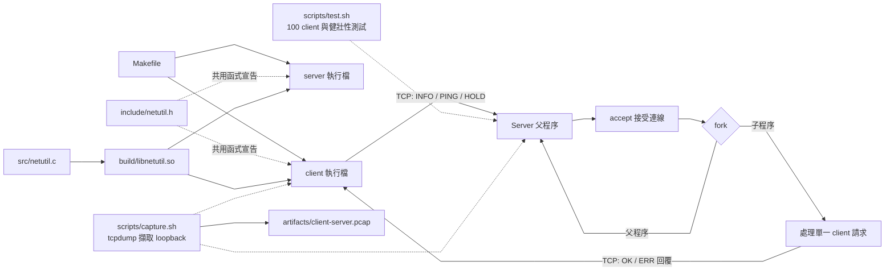

# 期中專案報告

## 1. 系統設計

本專案採用 Linux/POSIX TCP client/server 架構。
伺服器預設監聽 `127.0.0.1:5050`，每次 `accept()` 成功後由父程序呼叫 `fork()`；
子程序處理單一連線後結束，父程序關閉該連線描述符並繼續接受新連線。
`SIGCHLD` handler 使用 `waitpid(..., WNOHANG)` 回收子程序，避免 zombie。listen backlog 設為 64；本機 100 client 的實際併發驗證由 `make test` 完成。

應用層使用一行一個命令的純文字協定：`INFO`、`PING`、`HOLD 1..30`，每個回覆以 `OK` 或 `ERR` 開頭。`INFO` 取得 hostname、作業系統、核心版本、架構和 CPU 數。
`HOLD` 是可控的延遲命令，用於驗證多個子程序確實重疊執行，不是效能用途。

兩端共用的 logging、完整傳送、行接收、socket timeout、port 驗證封裝在 `libnetutil.so`。
Makefile 將 client/server 動態連結此函式庫，並設定 `$ORIGIN` rpath，讓執行檔能在 `build/` 找到同目錄的 shared object。



## 2. 健壯性設計

預設模式使用 255-byte 上限與 newline framing；超長資料拒絕處理，缺少 delimiter 時 5 秒後回覆 timeout，命令需完整符合協定。
client/server 皆設定 socket timeout；共用傳送函式處理部分寫入和 `EINTR`，採用 `MSG_NOSIGNAL` 避免對端關閉造成 SIGPIPE。
伺服器也處理 `accept()` 中斷、fork 失敗、socket 設定錯誤與子程序回收；CLI 檢查 IPv4 位址及 1..65535 port。

`--legacy-demo` 僅用於呈現錯誤處理差異：將一次 `recv()` 當成完整訊息、不設定伺服器讀取 timeout，並允許 `PING`/`INFO` 後綴。它仍保留固定大小緩衝區，避免教學範例本身造成記憶體破壞；不可用於正式環境。

## 3. 關鍵原始碼

| 檔案 | 職責 |
| --- | --- |
| `src/server.c` | listener、`accept()`/`fork()`、子程序生命週期、請求驗證、系統資訊收集 |
| `src/client.c` | 命令列解析、TCP 連線、請求傳送及逾時回覆處理 |
| `src/netutil.c` | 動態共用的 log、`send_all()`、line receive、socket timeout 和 port parser |
| `include/netutil.h` | client/server 共用函式宣告與封包大小常數 |
| `Makefile` | `.so`、client、server 建置及測試/抓包入口 |
| `scripts/test.sh` | 三組錯誤輸入對照及 100 client runtime proof |
| `scripts/capture.sh` | tcpdump loopback 擷取與封包文字解碼 |

Debug 有兩層：編譯期 `DEBUG=1/0` 決定是否把 DEBUG 日誌編入；執行期 `--verbose` 控制已編入的 DEBUG 日誌是否輸出。
WARN/ERROR/INFO 不會被關閉。

## 4. 建置與執行

```sh
make clean && make DEBUG=1
./build/server --verbose 127.0.0.1 5050
./build/client --verbose 127.0.0.1 5050 INFO
./build/client 127.0.0.1 5050 PING
make test
```

`make test` 產生 `artifacts/robustness-examples.txt`、`artifacts/concurrency-proof.txt`、server log 及 100 個 client 回覆檔。
以 `make clean && make DEBUG=0` 可驗證編譯期關閉 DEBUG。

## 5. 健壯性實驗

執行 `make test` 會在兩個本機 port 啟動 robust server 與 `--legacy-demo` server，逐項送出同一個原始 TCP payload。
實際輸出寫入 `artifacts/robustness-examples.txt`；下表描述預期觀察，提交前請以產生的 log 核對並附上終端截圖。

| 案例 | 輸入 | Robust 模式 | Legacy demo |
| --- | --- | --- | --- |
| 1. 未送 newline | `PING`（連線仍開啟） | 5 秒後回覆 `ERR request timed out` | 把單次 recv 當完整命令，錯誤地回覆 `OK PONG` |
| 2. 超長封包 | `PING` + 300 個 `x` + newline | 回覆 `ERR request too long` | 只讀固定緩衝區前段，錯誤地回覆 `OK PONG` |
| 3. 命令尾隨垃圾 | `INFO garbage` | 回覆 `ERR invalid request` | 前綴比對通過，錯誤地回傳 system info |

以上結果顯示 framing、長度上限、timeout 和完整命令驗證如何避免不完整或無效輸入被當成有效命令。
Legacy 測試僅限本機 loopback。

## 6. 100 客戶端併發證明

`make test` 預設同時啟動 100 個 client，各自要求伺服器執行 `HOLD 3`。
本次實測 100/100 成功，牆鐘時間為 3.23 秒；若逐一處理則約需 300 秒。伺服器整場測試共記錄 109 筆 fork（包含基本命令與異常輸入測試）；併發區段列出 100 個不同的 worker PID。
完整輸出見 `artifacts/concurrency-proof.txt`，每個 client 的回覆另存於 `artifacts/concurrent-client-*.txt`。
可用環境變數 `CLIENT_COUNT` 調整測試數量。

## 7. 封包擷取與分析

本次使用 tcpdump 在 loopback `lo` 擷取 TCP port 25060，產生 `artifacts/client-server.pcap`。
tcpdump 統計 20 個封包寫入 pcap、40 個封包符合 filter、0 個封包遭 kernel 丟棄。
擷取內容包含兩條 client/server 連線：來源埠 52026 傳送 5-byte `PING`，伺服器回覆 8-byte `OK PONG`；來源埠 52040 傳送 5-byte `INFO`，伺服器回覆 86-byte system information。
兩條連線皆可辨認 SYN、SYN-ACK、ACK 三向交握、資料與 ACK，以及 FIN 關閉流程。
`tcpdump -nn -A -r artifacts/client-server.pcap 'tcp port 25060'` 已確認 payload 可讀；協定未加密是本教學範例的限制。

`artifacts/packet-analysis.txt` 保存封包摘要。
提交時附上該摘要的終端截圖，以及 Wireshark 開啟 `client-server.pcap`、以 `tcp.port == 25060` 過濾並選取含 `INFO` 回覆封包的畫面。
埠號可依 `CAPTURE_PORT` 調整。

## 8. 截圖與影片提交清單

- 截圖 A：編譯成功、`INFO` 回覆與 server `--verbose` log。
- 截圖 B：`artifacts/concurrency-proof.txt` 的 100/100、總時間及 fork worker PID。
- 截圖 C：三組 robust/legacy 對照輸出。
- 截圖 D：Wireshark 的 TCP handshake 與明文 INFO/OK 封包，或 tcpdump 解碼畫面。
- 影片：依 `report/VIDEO_SCRIPT.md` 錄製約 2 分鐘，展示 build、INFO、併發與一個健壯性差異。

截圖與 pcap 應由學生在自己的課堂電腦執行後保存；不可用預期輸出冒充實測截圖。

## 9. 完整原始碼附錄

以下內容由提交時使用的原始檔逐一收錄；編譯與測試所需檔案均列於此。
為方便閱讀，程式碼區塊加入繁體中文解說註解；這些註解只存在於報告，不改動工作區中實際編譯的原始檔。

### src/server.c

```c
#define _POSIX_C_SOURCE 200809L
#include "netutil.h"

#include <arpa/inet.h>
#include <errno.h>
#include <netinet/in.h>
#include <signal.h>
#include <stdio.h>
#include <stdlib.h>
#include <string.h>
#include <sys/socket.h>
#include <sys/types.h>
#include <sys/wait.h>
#include <time.h>
#include <unistd.h>
#include <sys/utsname.h>

#define REQUEST_TIMEOUT_SECONDS 5
#define MAX_HOLD_SECONDS 30

/* 子程序結束時回收它，避免留下 zombie process。 */
static void reap_children(int signal_number)
{
    (void)signal_number;
    while (waitpid(-1, NULL, WNOHANG) > 0) {
    }
}

static void send_error(int client_fd, const char *message)
{
    char response[MAX_RESPONSE];
    int length = snprintf(response, sizeof(response), "ERR %s\n", message);
    if (length > 0 && (size_t)length < sizeof(response)) {
        (void)send_all(client_fd, response, (size_t)length);
    }
}

/* 依命令產生回覆；legacy 模式刻意以命令前綴比對展示驗證差異。 */
static void handle_request(int client_fd, const char *request, int robust_mode)
{
    char response[MAX_RESPONSE];
    int length = -1;

    if (strcmp(request, "PING") == 0 || (!robust_mode && strncmp(request, "PING", 4) == 0)) {
        length = snprintf(response, sizeof(response), "OK PONG\n");
    } else if (strcmp(request, "INFO") == 0 || (!robust_mode && strncmp(request, "INFO", 4) == 0)) {
        struct utsname system_info;
        long cpu_count = sysconf(_SC_NPROCESSORS_ONLN);
        char hostname[256] = "unknown";

        (void)gethostname(hostname, sizeof(hostname) - 1);
        hostname[sizeof(hostname) - 1] = '\0';
        if (uname(&system_info) == 0) {
            length = snprintf(response, sizeof(response),
                              "OK host=%s os=%s release=%s arch=%s cpus=%ld\n",
                              hostname, system_info.sysname, system_info.release,
                              system_info.machine, cpu_count);
        }
    } else if (strncmp(request, "HOLD ", 5) == 0) {
        char extra;
        int seconds = 0;
        if (sscanf(request, "HOLD %d %c", &seconds, &extra) == 1 &&
            seconds >= 1 && seconds <= MAX_HOLD_SECONDS) {
            (void)sleep((unsigned int)seconds);
            length = snprintf(response, sizeof(response), "OK held %d seconds\n", seconds);
        } else {
            send_error(client_fd, "HOLD duration must be 1..30 seconds");
            return;
        }
    } else {
        send_error(client_fd, "invalid request; use INFO, PING, or HOLD seconds");
        return;
    }

    if (length < 0 || (size_t)length >= sizeof(response)) {
        send_error(client_fd, "response could not be created");
        return;
    }
    if (send_all(client_fd, response, (size_t)length) < 0) {
        log_warn("failed to send response: %s", strerror(errno));
    }
}

/* 設定讀取逾時、讀取一行請求，並把超長或未完成輸入回報為錯誤。 */
static void handle_client(int client_fd, int robust_mode)
{
    char request[MAX_REQUEST];
    int result;

    if (robust_mode && set_socket_timeout(client_fd, REQUEST_TIMEOUT_SECONDS) < 0) {
        log_warn("cannot set client timeout: %s", strerror(errno));
    }
    result = receive_line(client_fd, request, sizeof(request), robust_mode);
    if (result == -2) {
        send_error(client_fd, "request too long (maximum 255 bytes)");
        log_warn("rejected oversized request");
        return;
    }
    if (result == -3) {
        send_error(client_fd, "incomplete request; newline required");
        log_warn("rejected request without terminating newline");
        return;
    }
    if (result < 0) {
        if (errno == EAGAIN || errno == EWOULDBLOCK) {
            send_error(client_fd, "request timed out");
            log_warn("client request timed out");
        } else {
            log_warn("failed to read request: %s", strerror(errno));
        }
        return;
    }
    if (result == 0) {
        log_debug("client disconnected before sending a request");
        return;
    }

    log_debug("received request: %s", request);
    handle_request(client_fd, request, robust_mode);
}

static void print_usage(const char *program)
{
    fprintf(stderr, "Usage: %s [--verbose] [--legacy-demo] [address] [port]\n", program);
}

/* 建立 TCP listener，之後由父程序持續 accept 新連線。 */
int main(int argc, char **argv)
{
    const char *address = "127.0.0.1";
    const char *port_text = "5050";
    int verbose = 0;
    int robust_mode = 1;
    int argument = 1;
    unsigned short port;
    struct sockaddr_in server_address;
    struct sigaction child_action;
    int server_fd;
    int reuse_address = 1;

    while (argument < argc && argv[argument][0] == '-') {
        if (strcmp(argv[argument], "--verbose") == 0) {
            verbose = 1;
        } else if (strcmp(argv[argument], "--legacy-demo") == 0) {
            robust_mode = 0;
        } else {
            print_usage(argv[0]);
            return EXIT_FAILURE;
        }
        argument++;
    }
    if (argc - argument > 2) {
        print_usage(argv[0]);
        return EXIT_FAILURE;
    }
    if (argc - argument >= 1) {
        address = argv[argument++];
    }
    if (argc - argument == 1) {
        port_text = argv[argument];
    }
    if (parse_port(port_text, &port) < 0 || inet_pton(AF_INET, address, &server_address.sin_addr) != 1) {
        print_usage(argv[0]);
        fprintf(stderr, "Address must be IPv4 and port must be 1..65535.\n");
        return EXIT_FAILURE;
    }

    log_set_debug(verbose);
    (void)signal(SIGPIPE, SIG_IGN);
    memset(&child_action, 0, sizeof(child_action));
    child_action.sa_handler = reap_children;
    sigemptyset(&child_action.sa_mask);
    child_action.sa_flags = SA_RESTART | SA_NOCLDSTOP;
    if (sigaction(SIGCHLD, &child_action, NULL) < 0) {
        perror("sigaction");
        return EXIT_FAILURE;
    }

    server_fd = socket(AF_INET, SOCK_STREAM, 0);
    if (server_fd < 0) {
        perror("socket");
        return EXIT_FAILURE;
    }
    if (setsockopt(server_fd, SOL_SOCKET, SO_REUSEADDR, &reuse_address, sizeof(reuse_address)) < 0) {
        perror("setsockopt");
        close(server_fd);
        return EXIT_FAILURE;
    }
    memset(&server_address, 0, sizeof(server_address));
    server_address.sin_family = AF_INET;
    server_address.sin_port = htons(port);
    if (inet_pton(AF_INET, address, &server_address.sin_addr) != 1 ||
        bind(server_fd, (struct sockaddr *)&server_address, sizeof(server_address)) < 0 ||
        listen(server_fd, 64) < 0) {
        perror("bind/listen");
        close(server_fd);
        return EXIT_FAILURE;
    }

    log_info("listening on %s:%u; mode=%s; compile_debug=%d runtime_debug=%d",
             address, port, robust_mode ? "robust" : "legacy-demo",
             DEBUG_BUILD, verbose);
    for (;;) {
        int client_fd = accept(server_fd, NULL, NULL);
        if (client_fd < 0) {
            if (errno == EINTR) {
                continue;
            }
            log_error("accept failed: %s", strerror(errno));
            continue;
        }

        /* 每條已接受的連線各 fork 一個 child process 處理。 */
        pid_t child_pid = fork();
        if (child_pid < 0) {
            log_error("fork failed: %s", strerror(errno));
            send_error(client_fd, "server is temporarily unable to accept a worker");
            close(client_fd);
            continue;
        }
        if (child_pid == 0) {
            /* 子程序只服務這條連線；關閉不屬於它的 listener。 */
            close(server_fd);
            log_debug("handling new client connection");
            handle_client(client_fd, robust_mode);
            close(client_fd);
            _exit(EXIT_SUCCESS);
        }
        log_debug("forked worker pid=%ld", (long)child_pid);
        close(client_fd);
    }
}
```

### src/client.c

```c
#define _POSIX_C_SOURCE 200809L
#include "netutil.h"

#include <arpa/inet.h>
#include <errno.h>
#include <netinet/in.h>
#include <stdio.h>
#include <stdlib.h>
#include <string.h>
#include <sys/socket.h>
#include <unistd.h>

#define CLIENT_TIMEOUT_SECONDS 8

/* 命令列錯誤時顯示用法，不嘗試建立連線。 */
static void print_usage(const char *program)
{
    fprintf(stderr, "Usage: %s [--verbose] [--raw] address port [request]\n", program);
    fprintf(stderr, "Examples: %s 127.0.0.1 5050 INFO | PING | HOLD 3\n", program);
}

int main(int argc, char **argv)
{
    int verbose = 0;
    int raw_request = 0;
    int argument = 1;
    const char *address;
    unsigned short port;
    struct sockaddr_in server_address;
    char request[MAX_REQUEST];
    char response[MAX_RESPONSE];
    size_t request_length;
    int socket_fd;
    int received;

    while (argument < argc && argv[argument][0] == '-') {
        if (strcmp(argv[argument], "--verbose") == 0) {
            verbose = 1;
        } else if (strcmp(argv[argument], "--raw") == 0) {
            raw_request = 1;
        } else {
            print_usage(argv[0]);
            return EXIT_FAILURE;
        }
        argument++;
    }
    if (argc - argument < 2 || argc - argument > 3) {
        print_usage(argv[0]);
        return EXIT_FAILURE;
    }
    address = argv[argument++];
    if (parse_port(argv[argument++], &port) < 0 || inet_pton(AF_INET, address, &server_address.sin_addr) != 1) {
        fprintf(stderr, "Address must be IPv4 and port must be 1..65535.\n");
        return EXIT_FAILURE;
    }

    /* 未提供命令時預設請求 INFO；一般請求以 newline 結尾。 */
    if (argument == argc) {
        memcpy(request, "INFO", 5);
    } else {
        int length = snprintf(request, sizeof(request), "%s", argv[argument]);
        if (length < 0 || (size_t)length >= sizeof(request) - (raw_request ? 0u : 1u)) {
            fprintf(stderr, "Request is too long (maximum 255 bytes).\n");
            return EXIT_FAILURE;
        }
    }
    request_length = strlen(request);
    if (!raw_request) {
        request[request_length++] = '\n';
        request[request_length] = '\0';
    }

    log_set_debug(verbose);
    socket_fd = socket(AF_INET, SOCK_STREAM, 0);
    if (socket_fd < 0) {
        perror("socket");
        return EXIT_FAILURE;
    }
    if (set_socket_timeout(socket_fd, CLIENT_TIMEOUT_SECONDS) < 0) {
        perror("setsockopt timeout");
        close(socket_fd);
        return EXIT_FAILURE;
    }
    memset(&server_address, 0, sizeof(server_address));
    server_address.sin_family = AF_INET;
    server_address.sin_port = htons(port);
    if (inet_pton(AF_INET, address, &server_address.sin_addr) != 1) {
        fprintf(stderr, "Invalid IPv4 address.\n");
        close(socket_fd);
        return EXIT_FAILURE;
    }
    /* 建立 TCP 連線後送出請求，並等待 server 的一行回覆。 */
    if (connect(socket_fd, (struct sockaddr *)&server_address, sizeof(server_address)) < 0) {
        perror("connect");
        close(socket_fd);
        return EXIT_FAILURE;
    }
    log_debug("connected to %s:%u", address, port);
    if (send_all(socket_fd, request, request_length) < 0) {
        perror("send");
        close(socket_fd);
        return EXIT_FAILURE;
    }
    received = receive_line(socket_fd, response, sizeof(response), 1);
    if (received <= 0) {
        if (received < 0 && (errno == EAGAIN || errno == EWOULDBLOCK)) {
            fprintf(stderr, "Server response timed out.\n");
        } else {
            perror("receive");
        }
        close(socket_fd);
        return EXIT_FAILURE;
    }
    puts(response);
    close(socket_fd);
    return strncmp(response, "ERR ", 4) == 0 ? EXIT_FAILURE : EXIT_SUCCESS;
}
```

### src/netutil.c

```c
#define _POSIX_C_SOURCE 200809L
#include "netutil.h"

#include <errno.h>
#include <stdlib.h>
#include <stdarg.h>
#include <stdio.h>
#include <string.h>
#include <sys/socket.h>
#include <sys/time.h>
#include <time.h>
#include <unistd.h>

static int runtime_debug_enabled;

/* 將每筆日誌組成單行後一次寫出，避免多個 child 的訊息互相穿插。 */
static void log_message(const char *level, const char *format, va_list arguments)
{
    time_t now = time(NULL);
    struct tm timestamp;
    char time_text[32];
    char line[1024];
    int prefix_length;
    int message_length;
    ssize_t written;
    size_t line_length;

    localtime_r(&now, &timestamp);
    strftime(time_text, sizeof(time_text), "%Y-%m-%d %H:%M:%S", &timestamp);
    prefix_length = snprintf(line, sizeof(line), "%s %-5s pid=%ld ",
                             time_text, level, (long)getpid());
    if (prefix_length < 0 || (size_t)prefix_length >= sizeof(line)) {
        return;
    }
    message_length = vsnprintf(line + prefix_length, sizeof(line) - (size_t)prefix_length,
                               format, arguments);
    if (message_length < 0) {
        return;
    }
    line_length = (size_t)prefix_length + (size_t)message_length;
    if (line_length >= sizeof(line) - 1) {
        line_length = sizeof(line) - 2;
    }
    line[line_length++] = '\n';
    written = write(STDERR_FILENO, line, line_length);
    if (written != (ssize_t)line_length) {
        return;
    }
}

static void log_with_level(const char *level, const char *format, va_list arguments)
{
    log_message(level, format, arguments);
}

void log_set_debug(int enabled)
{
    runtime_debug_enabled = enabled;
}

void log_info(const char *format, ...)
{
    va_list arguments;
    va_start(arguments, format);
    log_with_level("INFO", format, arguments);
    va_end(arguments);
}

void log_warn(const char *format, ...)
{
    va_list arguments;
    va_start(arguments, format);
    log_with_level("WARN", format, arguments);
    va_end(arguments);
}

void log_error(const char *format, ...)
{
    va_list arguments;
    va_start(arguments, format);
    log_with_level("ERROR", format, arguments);
    va_end(arguments);
}

/* DEBUG_BUILD 控制是否編入；runtime_debug_enabled 控制是否輸出。 */
void log_debug(const char *format, ...)
{
#if DEBUG_BUILD
    if (runtime_debug_enabled) {
        va_list arguments;
        va_start(arguments, format);
        log_with_level("DEBUG", format, arguments);
        va_end(arguments);
    }
#else
    (void)format;
#endif
}

/* TCP 可能只送出部分資料；持續傳送直到完成，並處理 EINTR。 */
ssize_t send_all(int socket_fd, const void *buffer, size_t length)
{
    const char *cursor = buffer;
    size_t sent = 0;

    while (sent < length) {
        ssize_t result = send(socket_fd, cursor + sent, length - sent, MSG_NOSIGNAL);
        if (result < 0) {
            if (errno == EINTR) {
                continue;
            }
            return -1;
        }
        if (result == 0) {
            errno = EPIPE;
            return -1;
        }
        sent += (size_t)result;
    }
    return (ssize_t)sent;
}

/* robust 模式逐 byte 讀到 newline，並限制長度；legacy 模式只呼叫一次 recv。 */
int receive_line(int socket_fd, char *buffer, size_t capacity, int robust_mode)
{
    size_t used = 0;

    if (capacity < 2) {
        errno = EINVAL;
        return -1;
    }

    if (!robust_mode) {
        ssize_t result = recv(socket_fd, buffer, capacity - 1, 0);
        if (result <= 0) {
            return (int)result;
        }
        used = (size_t)result;
        buffer[used] = '\0';
        char *newline = strchr(buffer, '\n');
        if (newline != NULL) {
            *newline = '\0';
        }
        return 1;
    }

    for (;;) {
        char character;
        ssize_t result = recv(socket_fd, &character, 1, 0);
        if (result < 0) {
            if (errno == EINTR) {
                continue;
            }
            return -1;
        }
        if (result == 0) {
            if (used == 0) {
                return 0;
            }
            buffer[used] = '\0';
            return -3;
        }
        if (character == '\n') {
            buffer[used] = '\0';
            return 1;
        }
        if (character == '\r') {
            continue;
        }
        if (used == capacity - 1) {
            buffer[used] = '\0';
            return -2;
        }
        buffer[used++] = character;
    }
}

/* 同時設定接收與傳送 timeout，避免 socket 永久卡住。 */
int set_socket_timeout(int socket_fd, int seconds)
{
    struct timeval timeout = { .tv_sec = seconds, .tv_usec = 0 };
    if (setsockopt(socket_fd, SOL_SOCKET, SO_RCVTIMEO, &timeout, sizeof(timeout)) < 0) {
        return -1;
    }
    return setsockopt(socket_fd, SOL_SOCKET, SO_SNDTIMEO, &timeout, sizeof(timeout));
}

/* 嚴格檢查 port 文字是否為 1 到 65535 的整數。 */
int parse_port(const char *text, unsigned short *port)
{
    char *end = NULL;
    long parsed;

    if (text == NULL || text[0] == '\0' || port == NULL) {
        return -1;
    }
    errno = 0;
    parsed = strtol(text, &end, 10);
    if (errno != 0 || end == text || *end != '\0' || parsed < 1 || parsed > 65535) {
        return -1;
    }
    *port = (unsigned short)parsed;
    return 0;
}
```

### include/netutil.h

```c
#ifndef NETUTIL_H
#define NETUTIL_H

#include <stddef.h>
#include <sys/types.h>

/* 緩衝區保留最後一格給字串結尾，因此有效請求最多 255 bytes。 */
#define MAX_REQUEST 256
#define MAX_RESPONSE 2048

/* 下列函式由 client 與 server 共用，實作位於 libnetutil.so。 */
void log_set_debug(int enabled);
void log_info(const char *format, ...);
void log_warn(const char *format, ...);
void log_error(const char *format, ...);
void log_debug(const char *format, ...);
ssize_t send_all(int socket_fd, const void *buffer, size_t length);
int receive_line(int socket_fd, char *buffer, size_t capacity, int robust_mode);
int set_socket_timeout(int socket_fd, int seconds);
int parse_port(const char *text, unsigned short *port);

#endif
```

### Makefile

```makefile
CC ?= gcc
DEBUG ?= 1
BUILD_DIR := build
# 編譯期控制 DEBUG 程式碼是否存在。
CPPFLAGS += -Iinclude -DDEBUG_BUILD=$(DEBUG)
CFLAGS += -std=c11 -Wall -Wextra -Wpedantic -O2 -fPIC
LDFLAGS += -L$(BUILD_DIR) -Wl,-rpath,'$$ORIGIN'
LDLIBS += -lnetutil

.PHONY: all clean test demo capture

all: $(BUILD_DIR)/server $(BUILD_DIR)/client

$(BUILD_DIR):
	mkdir -p $(BUILD_DIR)

$(BUILD_DIR)/netutil.o: src/netutil.c include/netutil.h | $(BUILD_DIR)
	$(CC) $(CPPFLAGS) $(CFLAGS) -c $< -o $@

# 先建置共用動態函式庫，再由 client/server 連結。
$(BUILD_DIR)/libnetutil.so: $(BUILD_DIR)/netutil.o
	$(CC) -shared -Wl,-soname,libnetutil.so -o $@ $^

$(BUILD_DIR)/server: src/server.c $(BUILD_DIR)/libnetutil.so
	$(CC) $(CPPFLAGS) $(CFLAGS) $< $(LDFLAGS) $(LDLIBS) -o $@

$(BUILD_DIR)/client: src/client.c $(BUILD_DIR)/libnetutil.so
	$(CC) $(CPPFLAGS) $(CFLAGS) $< $(LDFLAGS) $(LDLIBS) -o $@

test: all
	bash scripts/test.sh

demo: all
	bash scripts/demo.sh

capture: all
	bash scripts/capture.sh

clean:
	rm -rf $(BUILD_DIR)
```

### scripts/test.sh

```bash
#!/usr/bin/env bash
set -euo pipefail

ROOT_DIR="$(cd "$(dirname "${BASH_SOURCE[0]}")/.." && pwd)"
cd "$ROOT_DIR"
mkdir -p artifacts
ROBUST_PORT="${ROBUST_PORT:-25050}"
LEGACY_PORT="${LEGACY_PORT:-25051}"
CLIENT_COUNT="${CLIENT_COUNT:-100}"
SERVER_LOG="$ROOT_DIR/artifacts/server-test.log"
LEGACY_LOG="$ROOT_DIR/artifacts/server-legacy.log"
EXAMPLE_LOG="$ROOT_DIR/artifacts/robustness-examples.txt"
PROOF_LOG="$ROOT_DIR/artifacts/concurrency-proof.txt"

# 同時啟動有完整防護與教學用 legacy 模式的 server。
./build/server --verbose 127.0.0.1 "$ROBUST_PORT" >"$SERVER_LOG" 2>&1 &
ROBUST_PID=$!
./build/server --legacy-demo 127.0.0.1 "$LEGACY_PORT" >"$LEGACY_LOG" 2>&1 &
LEGACY_PID=$!
cleanup() {
    kill "$ROBUST_PID" "$LEGACY_PID" 2>/dev/null || true
    wait "$ROBUST_PID" "$LEGACY_PID" 2>/dev/null || true
}
trap cleanup EXIT

ready=0
for attempt in $(seq 1 200); do
    if ./build/client 127.0.0.1 "$ROBUST_PORT" PING >/dev/null 2>&1 &&
       ./build/client 127.0.0.1 "$LEGACY_PORT" PING >/dev/null 2>&1; then
        ready=1
        break
    fi
done
if [[ "$ready" != 1 ]]; then
    echo "Servers did not become ready; inspect artifacts/server-test.log" >&2
    exit 1
fi

# 以相同輸入比較兩種模式，再檢查 frame 長度與 EOF 邊界。
{
    echo "=== Basic client/server checks ==="
    ./build/client 127.0.0.1 "$ROBUST_PORT" PING
    ./build/client 127.0.0.1 "$ROBUST_PORT" INFO
    echo
    echo "=== Three robustness comparisons ==="
    python3 - "$ROBUST_PORT" "$LEGACY_PORT" <<'PY'
import socket
import sys

robust_port, legacy_port = map(int, sys.argv[1:])
examples = [
    ("1. Missing newline", b"PING"),
    ("2. Overlong frame", b"PING" + b"x" * 300 + b"\n"),
    ("3. Trailing garbage", b"INFO garbage\n"),
]

def request(port, payload):
    with socket.create_connection(("127.0.0.1", port), timeout=8) as connection:
        connection.settimeout(8)
        connection.sendall(payload)
        response = bytearray()
        while b"\n" not in response:
            chunk = connection.recv(4096)
            if not chunk:
                break
            response.extend(chunk)
        return response.decode(errors="replace").strip()

for title, payload in examples:
    robust = request(robust_port, payload)
    legacy = request(legacy_port, payload)
    print(title)
    print(f"  robust: {robust}")
    print(f"  legacy: {legacy}")
    if title == "1. Missing newline":
        assert "timed out" in robust and legacy == "OK PONG", (robust, legacy)
    elif title == "2. Overlong frame":
        assert "too long" in robust and legacy == "OK PONG", (robust, legacy)
    else:
        assert "invalid request" in robust and legacy.startswith("OK host="), (robust, legacy)

boundary_ok = request(robust_port, b"x" * 255 + b"\n")
boundary_long = request(robust_port, b"x" * 256 + b"\n")
print("Frame boundary")
print(f"  255-byte request: {boundary_ok}")
print(f"  256-byte request: {boundary_long}")
assert "too long" not in boundary_ok and "too long" in boundary_long

with socket.create_connection(("127.0.0.1", robust_port), timeout=8) as connection:
    connection.settimeout(8)
    connection.sendall(b"PING")
    connection.shutdown(socket.SHUT_WR)
    incomplete = connection.recv(4096).decode(errors="replace").strip()
    print(f"  EOF before newline: {incomplete}")
    assert "incomplete request" in incomplete
PY
} | tee "$EXAMPLE_LOG"

if ! [[ "$CLIENT_COUNT" =~ ^[1-9][0-9]*$ ]]; then
    echo "CLIENT_COUNT must be a positive integer." >&2
    exit 1
fi

# 每個背景 client 都要求 HOLD 3，用總耗時驗證連線是否重疊處理。
echo "=== $CLIENT_COUNT concurrent clients (each holds one child for 3 seconds) ===" | tee "$PROOF_LOG"
client_pids=()
start_ns="$(date +%s%N)"
for client_number in $(seq 1 "$CLIENT_COUNT"); do
    ./build/client 127.0.0.1 "$ROBUST_PORT" "HOLD 3" \
        >"artifacts/concurrent-client-${client_number}.txt" 2>&1 &
    client_pids+=("$!")
done
for client_index in "${!client_pids[@]}"; do
    if wait "${client_pids[$client_index]}"; then
        :
    fi
done
end_ns="$(date +%s%N)"
elapsed_ns=$((end_ns - start_ns))
elapsed_seconds="$(awk -v ns="$elapsed_ns" 'BEGIN { printf "%.2f", ns / 1000000000 }')"
response_count=0
for client_number in $(seq 1 "$CLIENT_COUNT"); do
    if grep -q '^OK held 3 seconds$' "artifacts/concurrent-client-${client_number}.txt"; then
        response_count=$((response_count + 1))
    fi
done
fork_count="$(grep -c 'forked worker pid=' "$SERVER_LOG" || true)"
printf 'Clients completed successfully: %s/%s\nElapsed wall time: %s seconds\nServer fork log entries: %s\n' \
    "$response_count" "$CLIENT_COUNT" "$elapsed_seconds" "$fork_count" | tee -a "$PROOF_LOG"
grep 'forked worker pid=' "$SERVER_LOG" | tail -n "$CLIENT_COUNT" | tee -a "$PROOF_LOG"
if [[ "$response_count" != "$CLIENT_COUNT" ]] || (( elapsed_ns >= 15000000000 )) || (( fork_count < CLIENT_COUNT )); then
    echo "Concurrency proof failed: expected $CLIENT_COUNT workers finishing in under 15 seconds." | tee -a "$PROOF_LOG"
    exit 1
fi
sequential_seconds=$((CLIENT_COUNT * 3))
echo "PASS: $CLIENT_COUNT clients overlapped; sequential handling would take about $sequential_seconds seconds." | tee -a "$PROOF_LOG"
echo "Test evidence saved under artifacts/."
```

### scripts/capture.sh

```bash
#!/usr/bin/env bash
set -euo pipefail
ROOT_DIR="$(cd "$(dirname "${BASH_SOURCE[0]}")/.." && pwd)"
cd "$ROOT_DIR"
PORT="${CAPTURE_PORT:-25060}"
mkdir -p artifacts

if ! command -v tcpdump >/dev/null 2>&1; then
    echo "tcpdump is not installed. On Ubuntu/WSL run: sudo apt update && sudo apt install tcpdump"
    exit 2
fi
if ! command -v sudo >/dev/null 2>&1; then
    echo "sudo is required to capture loopback packets; run this script as root instead."
    exit 2
fi
if ! command -v timeout >/dev/null 2>&1; then
    echo "GNU timeout is required to stop tcpdump cleanly."
    exit 2
fi

sudo -v
CAPTURE_FILE="$ROOT_DIR/artifacts/client-server.pcap"
CAPTURE_PID=""
SERVER_PID=""
cleanup() {
    if [[ -n "${SERVER_PID:-}" ]]; then
        kill "$SERVER_PID" 2>/dev/null || true
        wait "$SERVER_PID" 2>/dev/null || true
        SERVER_PID=""
    fi
    if [[ -n "${CAPTURE_PID:-}" ]]; then
        wait "$CAPTURE_PID" 2>/dev/null || true
        CAPTURE_PID=""
    fi
}
trap cleanup EXIT

# 用 timeout 發 SIGINT，讓 tcpdump 有機會將 pcap 正常收尾。
sudo timeout --signal=INT --kill-after=3s 8s tcpdump -i lo -U -nn -s 0 -w "$CAPTURE_FILE" "tcp port $PORT" \
    >"$ROOT_DIR/artifacts/tcpdump.log" 2>&1 &
CAPTURE_PID=$!
# 等到 tcpdump 確認開始監聽後才啟動 server 與 client 流量。
capture_ready=0
for attempt in $(seq 1 200); do
    if grep -q '^tcpdump: listening on' "$ROOT_DIR/artifacts/tcpdump.log"; then
        capture_ready=1
        break
    fi
    if ! kill -0 "$CAPTURE_PID" 2>/dev/null; then
        break
    fi
done
if [[ "$capture_ready" != 1 ]]; then
    echo "tcpdump did not become ready; inspect artifacts/tcpdump.log" >&2
    exit 1
fi

./build/server 127.0.0.1 "$PORT" >"$ROOT_DIR/artifacts/server-capture.log" 2>&1 &
SERVER_PID=$!

ready=0
for attempt in $(seq 1 200); do
    if ./build/client 127.0.0.1 "$PORT" PING >/dev/null 2>&1; then
        ready=1
        break
    fi
done
if [[ "$ready" != 1 ]]; then
    echo "Server did not become ready; inspect artifacts/server-capture.log" >&2
    exit 1
fi
./build/client 127.0.0.1 "$PORT" INFO | tee "$ROOT_DIR/artifacts/capture-client-output.txt"
cleanup
trap - EXIT
if [[ ! -s "$CAPTURE_FILE" ]] || (( $(stat -c '%s' "$CAPTURE_FILE") <= 24 )); then
    echo "Capture contains no packets; inspect artifacts/tcpdump.log" >&2
    exit 1
fi
tcpdump -nn -r "$CAPTURE_FILE" | tee "$ROOT_DIR/artifacts/packet-analysis.txt"
if [[ ! -s "$ROOT_DIR/artifacts/packet-analysis.txt" ]]; then
    echo "No packets were decoded from the capture." >&2
    exit 1
fi
echo "Capture saved to artifacts/client-server.pcap"
```

### scripts/demo.sh

```bash
#!/usr/bin/env bash
set -euo pipefail
ROOT_DIR="$(cd "$(dirname "${BASH_SOURCE[0]}")/.." && pwd)"
cd "$ROOT_DIR"
# 列出人工展示命令；完整自動化測試請執行 make test。
echo "Run the complete live demonstration and save its outputs with: make test"
echo "Then inspect artifacts/robustness-examples.txt and artifacts/concurrency-proof.txt."
echo
echo "Interactive example:"
echo "  ./build/server --verbose 127.0.0.1 5050"
echo "  ./build/client --verbose 127.0.0.1 5050 INFO"
echo "  ./build/client 127.0.0.1 5050 PING"
echo "  ./build/client 127.0.0.1 5050 'HOLD 3'"
```
